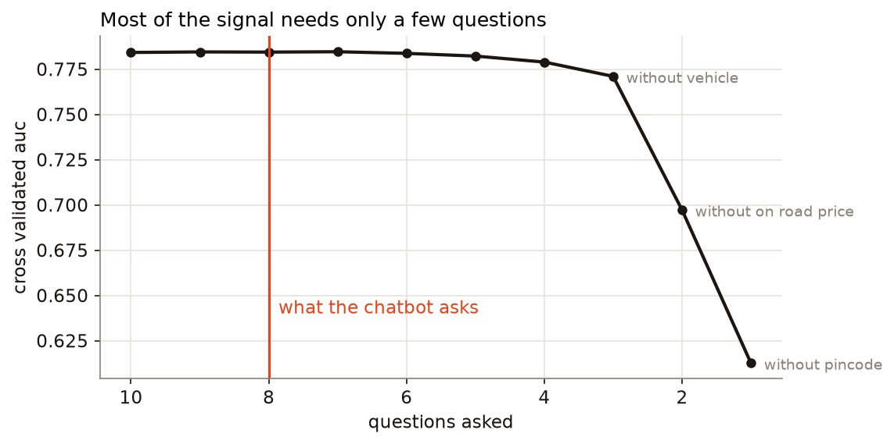
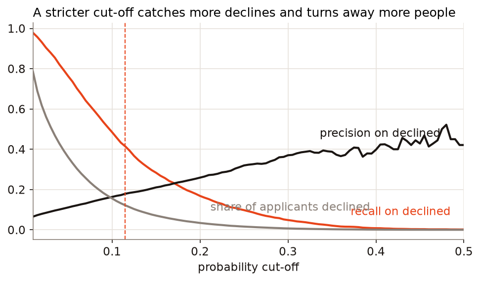

# ABC Credit loan chatbot

A chatbot that takes a two-wheeler loan application in a short conversation, scores it with a trained
model and returns approve or decline straight away, along with what influenced the result.

Mini project for Z6008.

**Live site:** https://abc-credit-loans.vercel.app

The training data isn't in this repo since it isn't mine to publish. Put `training_data.csv` in the repo root
if you want to rerun the pipeline. The site and the localhost version work without it.

## Against the brief

| The brief asks for | Where it is |
|---|---|
| Cleaning and preprocessing, data quality, encoding, feature selection | [pipeline/](pipeline), [notebooks/01_eda.ipynb](notebooks/01_eda.ipynb), report sections 2 to 4 |
| Trained model with reproducible training code | `python -m pipeline.train`, exported model in [server/creditbot/model](server/creditbot/model) |
| Chatbot: dynamic questions, model call, approve or decline, next steps, PII masking | the [live site](https://abc-credit-loans.vercel.app), [server/creditbot/chat.py](server/creditbot/chat.py), [privacy.py](server/creditbot/privacy.py) |
| Log of every input, answer, feature value and score | [audit.py](server/creditbot/audit.py), the `/audit` page (needs the key) |
| Predictions on the hold-out set | `python -m pipeline.predict test.csv predictions.csv`, ready for the file |
| Report: fields kept, data issues, model, metrics, latency, X and Y | [report/report.md](report/report.md) |
| Decision kept away from the language model | the decision is `probability >= cut-off` in [scorer.py](server/creditbot/scorer.py), tested in [tests/](tests) |

**X = 3 minutes, Y = 1 second.** A decision takes 530 ms (median), 731 ms at the 95th percentile, on the hosted site.

## What's different here

- **It's a real chat.** People can type the whole thing in one go, in English or Hinglish, such as "Jupiter 125, 98 hazaar
  on road, 20k down, I run a dukaan". Plain parsers handle short answers, and a language model reads longer ones. The
  side panel fills several fields from one message. Buttons are there only as shortcuts.
- **Answers are checked, not trusted.** Anything the language model pulls out goes through the same validators as typed
  input, and it's kept only if the message actually mentions that topic.
- **Reasons come from the model itself.** TreeSHAP values, grouped by question, under a disclaimer.
- **What-if slider.** Drag the down payment and the real model re-scores live.
- **Eight questions fill fifteen columns.** The vehicle answer fills make, model, variant and product, and the pincode
  fills tier and area. Each question was tested for what it adds.
- **Tamper-evident log.** Each row hashes the previous one, so an edited entry breaks the chain.
- **A stronger offline version.** The release zip runs a LightGBM and CatBoost blend on your own machine.

## How it works

A language model runs the conversation, and the trained model makes the decision. Every typed message goes through
three steps:

```
 applicant types ──► 1. UNDERSTAND   language model (Nemotron Ultra on NVIDIA NIM)
                        reads the message with the conversation so far and returns
                        what it says as data: answers, corrections, a question,
                        "show me my decision"
                              │
                              ▼
                     2. ACT          plain code
                        checks each value is really in the message, runs the same
                        validators as a typed answer, saves it, searches vehicles.
                        If the applicant asked for their decision and nothing is
                        missing, it calls the credit model:
                              │
                              ├──► LightGBM ► probability ≥ 11.5% ? declined : approved
                              │               + SHAP reasons, what-if, audit log
                              ▼
                     3. REPLY        language model
                        writes the next message from exactly what step 2 did,
                        and asks for the next missing detail in its own words
```

- **The decision never comes from the language model.** It can only signal that the applicant wants one. The result
  shown is the model's own output, and a reply that mentions approval or decline is blocked.
- **It can't invent answers.** A value is saved only if the applicant's message contains it. "70" can stand for ₹70,000
  only when the price is what was just asked, and "yes" to a suggested price needs an actual yes.
- **It reads context.** "no" to a suggested price, "3k i mean", "the comfort one", Hinglish ("25 hazaar", "koi loan nahi"),
  several answers in one message, and side questions all work.
- **Model choice.** On 12 tricky replies taken from real test chats, Nemotron Ultra read 12 of 12 right in three runs,
  against 8 of 12 for the smaller Nemotron Lightning. A turn takes about 3 to 5 seconds. The decision itself is under a
  second.
- **Fallback.** Buttons and a scripted state machine still work if NIM is down or the keys run out.

## Results

On a 20% test split that was kept locked during model selection (21,686 rows):

| | AUC | Avg. precision | Accuracy | Precision | Recall | F1 |
|---|---|---|---|---|---|---|
| Always approve | 0.500 | 0.053 | 94.7% | 0% | 0% | 0 |
| Hosted model (LightGBM) | 0.799 | 0.199 | 87.6% | 18.9% | 41.1% | 0.259 |
| Localhost model (LightGBM + CatBoost) | 0.801 | 0.200 | 85.0% | 17.5% | 49.7% | 0.259 |

Precision, recall and F1 are for the declined class. That split turned out to be a kind one: refitting on 8 other random
splits gave AUCs of 0.786 to 0.798, so about **0.79** is the fair number to expect on new data. With shuffled labels the
pipeline scores 0.50, so nothing is leaking.

The full reasoning is in [report/report.md](report/report.md), and the data exploration is in
[notebooks/01_eda.ipynb](notebooks/01_eda.ipynb).

## Choosing the questions

We dropped one question at a time and measured the loss in AUC with grouped cross-validation. Down payment and pincode
carry most of the signal. All eight questions score 0.784. Six would score almost the same, but we keep employment and
income because the brief asks for them and affordability needs them. Gender would add 0.0003 AUC, so it's left out on
principle. Residence and education were dropped.



## Choosing the cut-off

We assumed a bad approval costs about 8 times as much as a lost customer, and picked the cut-off with the lowest total
cost on out-of-fold predictions (11.5%). The ratio is an assumption, and this is how the choice moves with it:

| A bad approval costs | Cut-off | Declined | Recall | Precision | Accuracy |
|---|---|---|---|---|---|
| 2x a lost customer | 31.6% | 0.5% | 4.0% | 38.6% | 94.6% |
| 3x | 25.2% | 1.6% | 9.6% | 32.3% | 94.2% |
| 5x | 17.5% | 4.9% | 22.1% | 23.5% | 92.1% |
| **8x (chosen)** | **11.5%** | **12.2%** | **41.4%** | **17.9%** | **86.9%** |
| 10x | 8.7% | 19.3% | 55.3% | 15.1% | 81.3% |
| 15x | 6.3% | 28.9% | 68.6% | 12.5% | 73.1% |

(Out-of-fold, development rows. Recall and precision are for declines.)



## Data issues and what we did

| Found | Done |
|---|---|
| One fully empty row at the end | Dropped |
| Placeholder incomes like ₹1, ₹2, ₹25, ₹100 | Treated as missing, with a flag |
| Zero income for students and non-earners | Kept, it's real |
| 65 rows with LTV of exactly 0 | Estimated from loan amount and the model's usual price, flagged |
| 1,105 applicants above the stated age limit of 60 | Kept and flagged, they were clearly processed |
| Broken characters and spelling variants in model names | Normalised |
| Blank tier, make, variant and product cells | Filled from the pincode or model, which determine them |
| About 14,000 pincodes, most with under 20 rows | Smoothed target encoding on 2 and 3 digit areas, fitted out of fold |

## Groups

Error rates on the locked test rows. Gender isn't an input and both groups are close: women 11.2% declined by the model
and 43% recall, men 11.5% and 40%. Location is an input, and rural and semi-urban applicants get declined about 12% of the
time against 3 to 7% in the big cities, despite similar historical rates. We haven't resolved that gap, and the report
discusses it.

## Run it on your own machine

This is the stronger model, and it needs python 3.10 to 3.13 but no node.

1. Download `abc-credit-local.zip` from the [releases page](https://github.com/manasrpandya/abc-credit-chatbot/releases/latest) and unzip it.
2. **Mac or Linux:** open a terminal in the folder and run `sh start_mac_linux.sh`.
   **Windows:** double click `start_windows.bat`.
3. It sets itself up on the first run (a few minutes), then opens http://127.0.0.1:8000.

To turn on the language model, copy `.env.example` to `.env` and paste up to three NIM keys. It works fine without them.

## Working from source

Mac and Linux:

```sh
python3.12 -m venv .venv
.venv/bin/pip install -r requirements-train.txt
```

Windows:

```bat
py -3.12 -m venv .venv
.venv\Scripts\pip install -r requirements-train.txt
```

On a Mac, training also needs `brew install libomp` because of LightGBM. The app itself doesn't, since it walks the exported
trees in plain python.

Then, with `.venv/bin/python` (or `.venv\Scripts\python`) as `python`:

```sh
python -m pytest tests                 # no csv needed
python -m pipeline.search_fields       # which questions are worth asking
python -m pipeline.train               # compare models, evaluate, export
python -m pipeline.stability           # repeat on other splits, shuffled label check
python -m pipeline.figures             # charts for the report
python -m pipeline.site_data           # numbers for the site
python notebooks/build_eda.py          # rerun the notebook
```

To build the site (needs node), run `npm install` and `npm run build` in `web`. After that `python run_local.py` serves
the whole thing, or use `npm run dev` in `web` next to `uvicorn main:app --app-dir server` while working on it.

## Scoring a new file

```sh
python -m pipeline.predict test.csv predictions.csv            # hosted model
python -m pipeline.predict test.csv predictions.csv --better   # blended model
```

The input has the same columns as the training file, without `Decision`. Blank cells and unseen categories are fine.

## What's where

```
pipeline/    field search, training, evaluation, scoring a csv
server/      the api, chat flow, masking, audit log, tree scorer and the exported model
web/         the site (next.js, exported as static files)
notebooks/   data exploration
report/      the report, figures and the raw result files
tests/       scorer parity, leakage checks, masking, the chat flow
local/       start scripts and the release builder
```

Keys and secrets stay in `.env`, which is ignored.
