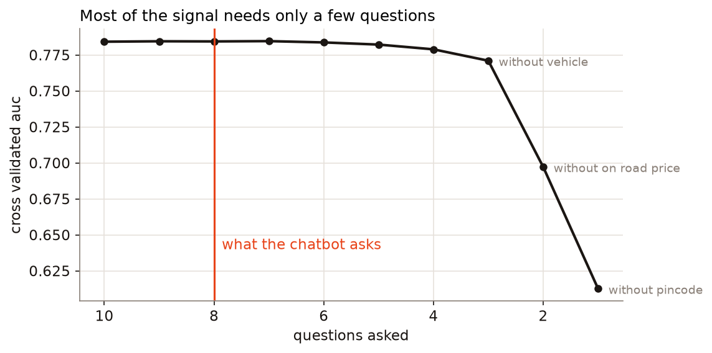
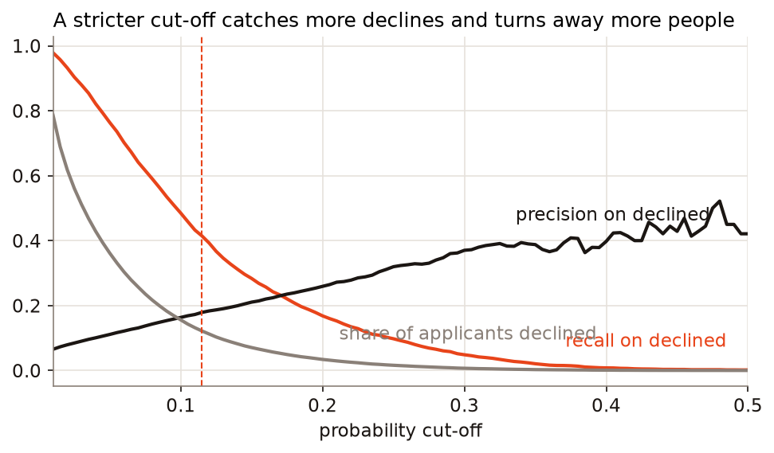
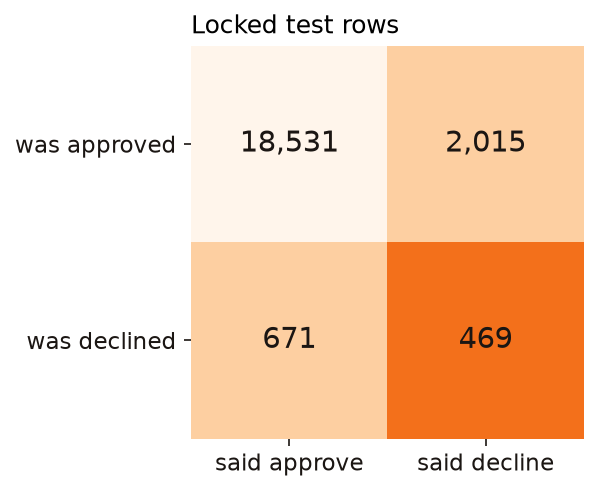

# ABC Credit loan approval chatbot: report

Live site: https://abc-credit-loans.vercel.app

## 1. Summary

The chatbot asks eight short questions and returns approve or decline with what influenced it. A trained LightGBM model makes the
decision. A language model only helps with the conversation.

| What the brief asks for | Our choice | Measured |
|---|---|---|
| Time to complete, X | 3 minutes | 8 questions, 7 for students and non-earners, most answered with one tap or a short number |
| Response after final input, Y | 1 second | 530 ms median, 731 ms at the 95th percentile, 1,016 ms worst, over 25 runs on the hosted site |
| Fields asked | 8 answers fill 12 of the 15 input columns | Within noise of asking everything (0.785 vs 0.784 AUC) |
| Expected AUC | | About 0.79 |
| Logging | Every question, answer, feature value and score | Masked, and chained so that edits show up |

## 2. What we found in the data, and what we did

There are 108,422 applications, of which 5,698 (5.26%) were declined. The full exploration is in `notebooks/01_eda.ipynb`.

| Issue | Evidence | What we did and why |
|---|---|---|
| Empty last row | One row with no id, and a single space as its age | Dropped. This is the "blank-string age" |
| Class imbalance | Always approving scores 94.74% accuracy | Compared models on AUC and average precision, and set the cut-off from costs |
| Placeholder incomes | 1, 2, 25 and 100 appear often; 106 rows fall between 1 and 999 | Set to missing, with a flag. They aren't rupee amounts |
| Zero income | 626 rows: 601 students, 6 non-earners, 19 with blank employment | Kept, since this is a real value |
| Zero LTV | 65 rows | Impossible on a financed vehicle. Estimated from the loan and the model's usual price, with a flag |
| Ages above policy | 1,105 rows aged 61 to 69, declined 3.35% of the time vs 5.28% | The brief says 18 to 60, but these were clearly processed. Kept and flagged. The chatbot scores them and logs a policy flag |
| Broken text | 4 model names contain `–`, which is utf-8 read as cp1252 | Normalised, so any spelling in the hidden set still matches |
| Inconsistent labels | `125 CC DISC` and `125CC DISC` | Merged |
| Blank categories | 3 to 27 blanks in several columns | Tier, make, variant and product are filled from pincode or model, which fully determine them |
| Duplicates | 14 repeated profiles over 30 rows, 3 with conflicting decisions | Kept, but identical profiles always stay on one side of a split |
| High cardinality pincode | 13,999 values, 12,701 of them with under 20 rows | Reduced to 2 and 3 digit prefixes |

Two findings shaped the design:

- **Some fields fully determine others.** Model description determines make, variant and product, with no exceptions across 87 models.
  Pincode determines tier across 13,981 pincodes. So one answer can fill several columns.
- **Implied vehicle price is stable.** Loan divided by LTV stays within about 4% for a given model. The bot can suggest a price for the
  applicant to confirm, then calculate LTV from the price and down payment, which people can actually answer.

**What the label means.** `Decision` records what the lender decided, not whether anyone repaid. The model learns to repeat past
decisions, including any bias in them. It doesn't measure default risk directly.

## 3. Features

All features are built by one function (`server/creditbot/features.py`) used for training, for scoring a csv and for the live chat, so
training and serving can't drift apart.

- **Money:** implied vehicle value, down payment, loan to income
- **Relative to the vehicle:** price, LTV and loan compared with that model's median
- **Relative to the area:** LTV and income compared with the 3 digit pincode area's median, price level by postal region, area size
- **Decline rate encodings:** smoothed rates for pincode prefixes (each backing off to its parent level), model, variant, make, employment and others
- **Flags:** zero income, placeholder income, repaired LTV, age above policy

Interactions we tried, such as pincode by product and LTV band by model, stayed within noise, so we left them out. Full 6 digit
pincode rates added only 0.001 AUC. We dropped them, which also keeps single-applicant rates out of a public repo.

**Leakage controls.** These are the things we checked, most with tests in `tests/test_leakage.py`:

1. Label based encodings are out of fold. Each row is encoded by the other folds. For validation and test rows they're fit only on training rows.
2. Medians and other lookups take no labels, and are fit on training rows only.
3. `ID` and `Decision` aren't inputs. `ID` shows no clear trend against the outcome anyway.
4. Identical profiles never straddle a split.
5. **Shuffled label test:** with the labels randomly shuffled, the whole pipeline scores 0.50 and 0.49 AUC, about what pure chance gives. A leak would show up as a score above that.

## 4. Choosing the fields

We searched over questions, not columns, because a question is what costs the applicant time. Each step removes the question whose loss
hurt least (3 fold cross validation, LightGBM).

| Questions | Removed | AUC | Avg. precision |
|---|---|---:|---:|
| 10 | none | 0.7842 | 0.177 |
| 9 | education | 0.7845 | 0.176 |
| 8 | income | 0.7844 | 0.178 |
| 7 | residence | 0.7846 | 0.177 |
| 6 | employment | 0.7837 | 0.176 |
| 5 | age | 0.7822 | 0.174 |
| 4 | active loans | 0.7789 | 0.169 |
| 3 | vehicle | 0.7710 | 0.163 |
| 2 | on-road price | 0.6972 | 0.118 |
| 1 | pincode | 0.6126 | 0.076 |

This order comes from removing questions one at a time, so "8 questions" in this table isn't the set we ask. Our final eight are vehicle,
on-road price, down payment, pincode, age, employment, income and active loans. We removed residence and education, and the final model
scored 0.785 in 5 fold cross validation.

- **Removed: gender** (a choice of principle, costing 0.0003 AUC), **education** and **residence** (no measurable loss).
- **Kept despite the numbers: employment and income.** Six questions would score about the same, and income adds almost nothing to
  predicting past decisions. We keep them because the brief lists employment and self-reported finances, and a lender needs them to judge
  affordability whatever the historical label says. It costs about 20 seconds. Removing them is a fair option if the shortest form is the only goal.
- **Why ask the price rather than use a catalogue price?** Asking keeps 0.0075 AUC, and it only takes one tap when the suggested price is right.

The flow is dynamic: the income question changes wording by employment type, students and non-earners skip it, the price question is prefilled from
the chosen vehicle, a message containing several answers can fill several steps, and anyone can change an answer before submitting.

## 5. Models

Five fold cross validation on the 80% development rows, with every label based step refit inside each fold.

| Model | AUC | Avg. precision |
|---|---:|---:|
| Logistic regression on the same features | 0.7751 | 0.165 |
| LightGBM with class weighting | 0.7850 | 0.176 |
| CatBoost | 0.7829 | 0.174 |
| **LightGBM (hosted)** | **0.7852** | **0.179** |
| LightGBM and CatBoost blend (localhost) | 0.7859 | 0.179 |

- **Feature engineering did more than model choice.** CatBoost on the 15 raw columns scored about 0.76 in an early single split, against about 0.785 here.
- **Class weighting didn't help ranking** and distorts probabilities, so we left it off and handled imbalance through the cut-off.
- **Monotonic constraints:** the model can't raise risk when the down payment rises. They cost nothing, and they keep the what-if slider believable.
- **Tuning isn't where the gains are.** Every tree model we tried lands between 0.78 and 0.79 in cross validation. The likely limit is the missing inputs, such as credit bureau data, and not the algorithm.

**Hosted vs localhost.** The blend gains about 0.001 AUC. That's real but small. It's offered through the release zip because CatBoost is too heavy for
a serverless function: the package alone is 268 MB. The hosted app needs no compiled model library at all. LightGBM's trees are exported to JSON and walked in plain python, and a test
checks that scores and SHAP values match LightGBM exactly. This also avoids the OpenMP dependency that LightGBM needs on a Mac.

## 6. The cut-off

Declined is the positive class. We chose the cut-off from a stated cost assumption, using calibrated out-of-fold predictions.

**Assumption: approving a bad case costs about 8 times as much as turning away a good one.** Rough working on the average loan of ₹89,000: losing about 60% of
principal is around ₹53,000, while net earnings on a good loan are perhaps ₹7,000 to ₹10,000, which gives 5 to 8 times. These are our assumptions and not ABC Credit's figures, so
the table below shows how the choice moves. Eight is also close to where F1 peaks on the development rows.

| Bad approval costs | Cut-off | Applicants declined | Recall | Precision | Accuracy |
|---:|---:|---:|---:|---:|---:|
| 2x | 31.6% | 0.5% | 4.0% | 38.6% | 94.6% |
| 3x | 25.2% | 1.6% | 9.6% | 32.3% | 94.2% |
| 5x | 17.5% | 4.9% | 22.1% | 23.5% | 92.1% |
| **8x** | **11.5%** | **12.2%** | **41.4%** | **17.9%** | **86.9%** |
| 10x | 8.7% | 19.3% | 55.3% | 15.1% | 81.3% |
| 15x | 6.3% | 28.9% | 68.6% | 12.5% | 73.1% |

The business trade-off is plain here. At 11.5% the model declines about 12% of applicants, more than the 5.3% declined historically, and that's the price of catching 41% of the past declines.
An evaluator who weighs lost customers more heavily should prefer 5x, which declines about the same share as today.

**A note on process.** Our first run used 5x. After seeing those results, including on the test rows, we moved to 8x because the brief stresses recall on the declined class and the
development table shows 8x has the best F1. AUC doesn't depend on the cut-off, but the test rows did get a second look for this one setting, so we report both. The hidden set is the clean check.

## 7. Results on the locked test rows

21,686 rows, 1,140 of them declined. The ranges are 95% bootstrap intervals.

| | AUC | Avg. precision | Accuracy | Precision | Recall | F1 |
|---|---:|---:|---:|---:|---:|---:|
| Always approve | 0.500 | 0.053 | 94.7% | 0% | 0% | 0 |
| **Hosted, 11.5% cut-off** | **0.7995** (0.788 to 0.812) | **0.199** | **87.6%** | **18.9%** | **41.1%** | **0.259** |
| Hosted at 5x, 17.5% cut-off | same | same | 92.5% | 24.6% | 20.6% | 0.224 |
| Localhost, 9.9% cut-off | 0.8014 (0.790 to 0.813) | 0.200 | 85.0% | 17.5% | 49.7% | 0.259 |

**The fair number is 0.79, not 0.80.** This split turned out to be a kind one, a little above the 0.785 from cross validation. So we refit the
frozen pipeline on 8 other random 80/20 splits, which gave 0.786 to 0.798, with a mean of 0.790 and a standard deviation of 0.004.

**Accuracy is below the naive baseline on purpose.** Catching declines means flagging people, and most flagged people were approved in the past, since declines are rare. Precision of 19%
is still about 3.6 times the 5.3% base rate. Precision this low also means many applicants the model declines would have been approved historically, so a real deployment would want
human review for those cases.

The brief's wording describes accuracy, precision and recall as independent of any cut-off. That description fits AUC, not those metrics, so we report both.

## 8. Fairness

On the locked test rows, at the chosen cut-off:

| Group | Rows | Declined historically | Declined by model | Recall |
|---|---:|---:|---:|---:|
| Female | 5,109 | 5.3% | 11.2% | 43.3% |
| Male | 16,577 | 5.3% | 11.5% | 40.5% |
| Megapolis (A) | 133 | 2.3% | 3.0% | 0.0% |
| Megapolis (B) | 744 | 5.5% | 6.9% | 29.3% |
| Large metro | 262 | 5.0% | 3.0% | 23.1% |
| Metro | 535 | 4.1% | 5.6% | 27.3% |
| Urban | 1,207 | 5.5% | 9.7% | 35.8% |
| Semi-urban | 4,311 | 5.4% | 12.0% | 44.2% |
| Rural | 14,494 | 5.3% | 12.1% | 42.2% |

Gender isn't an input, and outcomes are close. **Location is the concern:** rural and semi-urban applicants are declined about 12% of the time against 3 to 7% in the largest
cities, despite similar historical rates in several tiers. This may reflect higher LTVs and the local decline rates that the pincode features pick up, but we haven't separated those effects. Some of the small
groups have few declines, so their recall is noisy. Before any real use, this gap needs a review.

## 9. The chatbot

- **Separation.** The decision is `probability >= cut-off`, in code the language model can't reach. A test confirms that language model suggestions pass through the same validators as typed answers.
- **State machine.** It owns the order and the rules. Each answer goes through a plain parser first (35k, 1.2 lakh, 20%), so most turns don't use the language model at all.
- **Language model.** NVIDIA NIM, used for reading messy messages, side questions and wording the summary. It rotates across three keys and tries a chain of models. If all of that fails, the bot uses scripted text and still finishes.
- **Explanation guard.** A summary from the language model is dropped for a fixed template if it contradicts the decision, mentions a number that isn't in the facts, or uses words like "guarantee".
- **Why a result came out that way.** SHAP values from the model, grouped by answer and shown as plain reasons, under a disclaimer saying these are patterns in past decisions, not the formal reason or a statement of cause.
- **What-if slider.** Dragging the down payment re-scores with the same model, and applying with a new value creates a new logged decision.

## 10. Privacy and logging

- **Pincode** is cut to three digits in logs, including when typed into a free-text message.
- **PAN, Aadhaar, phone, email,** and names following "my name is" are removed before text is logged or sent to the language model. Plain names can't be spotted reliably, so we don't ask for one.
- **Callback numbers** are stored masked, with a keyed hash so repeats can be linked. A real deployment would need a separate secure contact store.
- **Log contents:** consent, each question, each answer with its source (button, typed or language model), rejected answers, language model calls, all feature values, probability, cut-off, decision, model version, timing, SHAP values and reasons.
- **Tamper evidence:** each row carries a hash of the previous one. A test confirms that an edit breaks the chain.
- **Stored in** Postgres on the hosted site and sqlite on localhost. The audit page needs a key on the hosted site.
- **Not masked:** age, income and vehicle, since the brief asks for every input and feature value to be logged. They aren't direct identifiers, but together they could narrow down a person, so access to the log has to stay restricted.

## 11. Latency, and our values of X and Y

Measured over 25 full applications on the hosted site, with the function in Singapore next to the database. The client was one machine connecting through Vercel's Cape Town edge, so applicants in India would see different network times.

| Step | Median | 95th percentile |
|---|---:|---:|
| Model scoring | 2.7 ms | 2.9 ms |
| Reasons (SHAP) | 183 ms | |
| Writing the log | 9.8 ms | 11.1 ms |
| All server work for a decision | 197 ms | 212 ms |
| **Final input to decision, at the client** | **530 ms** | **731 ms** |

The slowest of the 25 took 1,016 ms, just over target.

**Y = 1 second.** Median and 95th percentile are well inside it. Scoring alone takes under 3 ms, and most of what's left is the network. These runs were on a warm function. A cold start, or
the free database waking from sleep, can push a first request past a second (our first run after a deploy saw 3.1 s on the opening request), so the target applies to warm requests. Keeping an instance warm would close that gap in production.

Our first version took 1.4 seconds just to write the log, because it opened a new database connection each time. Reusing the connection brought that to about 10 ms.

**X = 3 minutes.** Eight questions at about 15 to 20 seconds each comes to around 2 to 3 minutes for a first-time user. An automated run takes under 15 seconds, so nearly all the time is the person reading and answering. We haven't timed real applicants. The log records completion time for each session, so this can be checked once people use it.

## 12. Limitations

- The labels are past decisions, not repayment, so this can't claim to predict default.
- Precision is low. Most applicants the model flags were approved historically.
- The cost ratio is our assumption and should come from ABC Credit's own numbers.
- The location gap in section 8 hasn't been resolved.
- The test rows were looked at a second time when we changed the cut-off (section 6).
- Ages above 60 are scored and flagged, pending clarity on the 18 to 60 policy.
- The brief gives no numeric benchmark, so we compared against the always-approve baseline and logistic regression.
